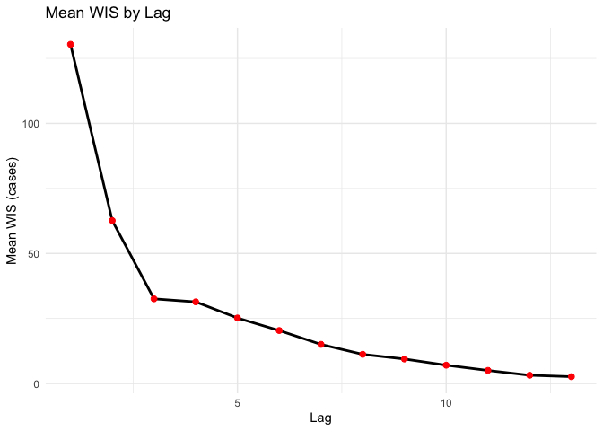
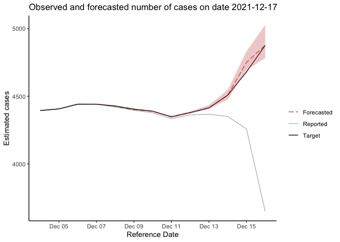
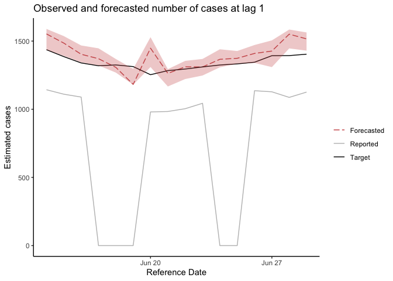

<!-- README.Rmd is used for generating README.md. -->

## \# DelphiRF: Delphi - Revision Forecast

Delphi-RF is a nonparametric quantile regression framework designed to
correct real-time data revisions in public health surveillance. By
modeling revision dynamics and incorporating all available updates up to
a given observation date, Delphi-RF generates distributional forecasts
of finalized surveillance values for both count and fraction-based data.

The preprocessing and forecasting functions return tibbles. They remain
compatible with data-frame operations and print a compact preview for
large results.

## Quick start

Most users should begin with one of two high-level functions:

- `delphirf_nowcast()` produces an operational nowcast at one forecast origin.
- `delphirf_backtest()` preprocesses a complete retrospective archive once and
  produces pseudoprospective nowcasts at several historical origins. Each fit
  still uses only information available by its origin.

Both functions accept a raw revision archive. By default they expect
`reference_date`, `lag`, `value`, and optionally `geo_value`. Column names can
be changed explicitly.

``` r
nowcast <- delphirf_nowcast(
  ma_dph,
  as_of = as.Date("2022-06-15"),
  value_col = "confirmed_case_7d_avg",
  refd_col = "test_date",
  lag_col = "lag",
  ref_lag = 14,
  smoothed = TRUE
)

backtest <- delphirf_backtest(
  ma_dph,
  test_dates = as.Date(c("2022-06-15", "2022-06-22", "2022-06-29")),
  value_col = "confirmed_case_7d_avg",
  refd_col = "test_date",
  lag_col = "lag",
  ref_lag = 14,
  smoothed = TRUE
)
```

For workflows that already call `data_preprocessing()`, use
`delphirf_nowcast_preprocessed()`. It is the lower-level modeling engine and
expects the prepared reporting triangle rather than a raw archive.

## \## Installation

You can install the package directly from GitHub using:

    devtools::install_github("cmu-delphi/DelphiRF")

If you have downloaded the package to a local directory, you can install
it with:

    install.packages("devtools")  # Install devtools if not already installed
    devtools::install("path/to/DelphiRF")  # Replace with the actual path

The default model backend uses the CRAN **quantreg** package, which is
installed with DelphiRF. The previous **quantgen** backend and its
linear programming solvers remain optional. To use that backend, follow
the installation instructions in the [quantgen GitHub
repository](https://github.com/ryantibs/quantgen) and set
`model_backend = "quantgen"` when fitting a model.

## \## Data Preprocessing

`data_preprocessing` processes input data for DelphiRF, ensuring it is
structured correctly for modeling. Users are required to specify:

-   `df`: A **data frame** containing the input data
-   `value_col`: A character vector naming the observed value column
    (count or directly supplied fraction) or the numerator and
    denominator columns (fraction)
-   `refd_col`: A string indicating the column containing the reference
    dates
-   `lag_col`: A string indicating the column containing lag values
-   `ref_lag`: The target lag used to select the completed revision
    value
-   `suffixes`: A **character vector** specifying suffixes for generated
    value columns (default: `c("")`)
-   `lagged_term_list`: An optional **numeric vector** of positive lag
    values, in days, to include in preprocessing
-   `value_type`: A string indicating the type of value (“count” or
    “fraction”) (default: “count”)
-   `temporal_resol`: The temporal resolution of the data, either
    `"daily"` or “weekly” (default: “daily”)
-   `smoothed`: A logical value (`TRUE`/`FALSE`) indicating whether the
    value column is already smoothed. When `TRUE`, preprocessing does
    not apply its own 7-day average (default: FALSE)
-   `target_as_of_date`: An optional last report date used when
    constructing completed revision values
-   `revision_start_lag`: An optional common initial-report lag or
    per-reference-date lookup for revision magnitude features. When
    omitted, DelphiRF builds the lookup internally from each reference
    date’s own first raw report.

One requested target lag, `L`, applies to the complete dataset. For a
reference date `t`, the target matures on `t + L`. If there is no raw
release exactly at lag `L`, DelphiRF carries forward the latest value
reported before `t + L`, but the target remains unavailable until
`t + L`. The prepared data retain `target_source_lag` and
`target_value_source` (`"exact_release"` or `"carried_forward"`) as
audit fields; they do not change `target_lag` or `target_date`. When
`target_as_of_date` is omitted, the maximum raw report date is used as
the archive boundary.

The returned data includes `genuine_event`. It is `TRUE` only for raw
reports with usable observed values: a non-missing value for count data,
or both a non-missing numerator and denominator for two-column fraction
data. A repeated, unchanged, non-missing report remains genuine. Raw
rows missing any required value, rows created by grid completion, and
carry-forward rows are marked `FALSE`. Reference-date episodes that
contain no usable raw report are removed. For retained episodes,
DelphiRF completes and fills the reporting grid before calculating 7-day
averages and lagged predictors, so non-genuine rows can still support
feature construction; `genuine_training` and `genuine_testing` remove
them afterward when requested. Fraction numerator and denominator values
are filled component-wise, so an incomplete fraction report is
non-genuine while its observed component can still affect later
constructed features.

For daily data, preprocessing retains all seven weekday indicators for
both reference and report dates. Automatic model construction uses
Monday through Saturday and omits Sunday from each set as the baseline
category.

For count data and fraction data supplied as one value column, DelphiRF
uses `log(value + 1)`. For fraction data supplied as numerator and
denominator columns, it uses
`log(numerator + 1) - log(denominator + 1)`.

For example, ma\_dph is a count-based dataset containing the 7-day
moving average of daily reported COVID-19 confirmed cases in MA.

    library(DelphiRF)
    library(ggplot2)
    library(dplyr)

    ##
    ## Attaching package: 'dplyr'

    ## The following objects are masked from 'package:stats':
    ##
    ##     filter, lag

    ## The following objects are masked from 'package:base':
    ##
    ##     intersect, setdiff, setequal, union

    data(ma_dph)
    tail(ma_dph)

    ##         test_date total_positive new_positive confirmed_case_7d_avg issue_date
    ## 257376 2022-07-14        1788698         1533              1470.286 2022-07-21
    ## 257377 2022-07-15        1790062         1364              1451.857 2022-07-21
    ## 257378 2022-07-16        1790912          850              1424.857 2022-07-21
    ## 257379 2022-07-17        1791840          928              1416.429 2022-07-21
    ## 257380 2022-07-18        1793065         1225              1329.286 2022-07-21
    ## 257381 2022-07-19        1793437          372              1122.714 2022-07-21
    ##        lag
    ## 257376   7
    ## 257377   6
    ## 257378   5
    ## 257379   4
    ## 257380   3
    ## 257381   2

During the preprocessing step, the user would specify the following for
ma\_dph:

    value_col <- "confirmed_case_7d_avg"
    refd_col <- "test_date"
    lag_col <- "lag"
    ref_lag <- 14
    smoothed <- TRUE

The data is preprocessed using the following steps:

    # Preprocess the data for a specific location
    df <- data_preprocessing(
      ma_dph,
      value_col = "confirmed_case_7d_avg",
      refd_col = "test_date",
      lag_col = "lag",
      ref_lag = 14,
      smoothed = TRUE
    )

    # Forecast origin and windows
    origin <- as.Date("2022-06-15")
    training_days <- 365
    test_dates <- seq(from = origin, to = as.Date("2022-06-30"), by = "day")

    # Training data: releases reported by the origin whose targets matured inside
    # the training window, so every training row is known at the origin
    train_data <- df %>%
      filter(report_date <= origin,
             target_date <= origin,
             target_date > origin - training_days)

    # Similarity weights compare each training row with the reporting context at
    # the origin: one anchor per lag, taken from all data reported by the origin
    anchors <- create_weight_anchors(df, origin)
    train_data <- add_weights_related(train_data, anchors)

    # Test data: releases reported in the testing window
    test_data <- df %>%
      filter(report_date %in% test_dates)

## Model Training and Forecast Generation

### Running the preprocessed-data engine

To forecast an already prepared reporting triangle using
`delphirf_nowcast_preprocessed()`, specify:

-   `df`: A **data frame** containing the input data.
-   `testing_start_date`: A **Date** object giving the forecast origin
    (e.g., `as.Date("2021-12-06")`).
-   `working_scale`: `"log_value"` when preprocessing received one value
    column (a count or a directly supplied rate), or `"log_ratio"` when
    it received numerator and denominator columns. This sets how
    predictions are returned to the reporting scale. It is required;
    there is no default.

Training rows are releases reported by the origin,
`report_date <= testing_start_date`, whose target matured inside the
training window,
`testing_start_date - training_days < target_date <= testing_start_date`.
Test rows are every row of `df` with
`report_date >= testing_start_date`; there is no upper limit, so pass
only the releases you want forecast.

The function takes the entire revision dataset as input and
automatically divides it into multiple `test_lag_groups`, where each
group is assumed to have the same revision pattern. For each
`test_lag_group`, the function trains the model and generates forecasts
as needed using fixed hyperparameters. By default, training and
prediction use only rows marked as usable raw observations by
`data_preprocessing`.

    # Forecast from the prepared reporting triangle
    results <- delphirf_nowcast_preprocessed(
      df, as.Date("2021-12-06"),
      working_scale = "log_value",
      model_save_dir = file.path(tempdir(), "DelphiRF-readme-models")
    )

    # Compute mean WIS for each lag, in cases (reporting scale)
    mean_wis_by_lag <- results %>%
      group_by(lag) %>%
      summarise(mean_wis = mean(wis_reporting, na.rm = TRUE))

    # Compute mean WIS score for each lag
    head(mean_wis_by_lag)

    ## # A tibble: 6 × 2
    ##     lag mean_wis
    ##   <dbl>    <dbl>
    ## 1     1    130.
    ## 2     2     62.6
    ## 3     3     32.5
    ## 4     4     31.4
    ## 5     5     25.2
    ## 6     6     20.3

    # Plot using ggplot2
    ggplot(mean_wis_by_lag, aes(x = lag, y = mean_wis)) +
      geom_line(color = "black", linewidth = 1) +  # Line plot
      geom_point(color = "red", size = 2) +  # Add points
      labs(title = "Mean WIS by Lag",
           x = "Lag",
           y = "Mean WIS (cases)") +
      theme_minimal()  # Apply a clean theme



    visual_part <- results %>%
      filter(report_date == as.Date("2021-12-17")) %>%
      filter(reference_date >= as.Date("2021-12-01"))

    ggplot(visual_part) + geom_line(aes(reference_date, predicted_tau0.5,col="Forecasted"), linetype="longdash") +
      geom_line(aes(reference_date, exp(log_value_7dav) - 1, col="Reported"),linetype="solid") +
      geom_line(aes(reference_date, exp(log_value_target_7dav) - 1, col="Target"),linetype="solid") +
      scale_colour_manual(name="",values=c("indianred3","gray", "black"))+
      theme_classic()+
      geom_ribbon(fill="indianred3",aes(x = reference_date,ymin=predicted_tau0.25,
                                        ymax=predicted_tau0.75),alpha=0.3)+
      xlab("Reference Date") + ylab("Estimated cases") +
      ggtitle("Observed and forecasted number of cases on date 2021-12-17")



#### Optional Arguments

The user may optionally specify the following arguments: - `taus`: A
**numeric vector** of quantiles to be estimated (default: `TAUS`).
Duplicate levels are removed while preserving their first-occurrence
order.
- `test_lag_groups`: A **vector** specifying the lag groups to be
tested. When omitted, DelphiRF selects `TEST_LAG_GROUPS_DAILY` or
`TEST_LAG_GROUPS_WEEKLY` from `temporal_resol`.
- `smoothed_target`: A **logical** value choosing the response column:
the 7-day-average target (`TRUE`) or the unsmoothed target (`FALSE`)
(default: `TRUE`).
- `lagged_term_list`: An **optional numeric vector** of positive lag
values, in days, to include in the model.
- `params_list`: An **optional character vector** of predictor-column
names. These columns form the model design matrix and override automatic
predictor selection. When omitted, it is built by `create_params_list()`.
- `lambda`: A **numeric** value representing the regularization
parameter for the model (default: 0.1).
- `gamma`: A **numeric** value representing the weight for the loss
function (default: 0.1).
- `lag_pad`: A **numeric** padding value, a two-element
`c(left_pad, right_pad)` vector, or a named list of such values by test
lag group. For a test lag range `[a, b]`, training uses lags from
`a - left_pad` through `b + right_pad`, while predictions remain
restricted to `[a, b]`. A scalar applies the same padding to both sides
(default: `LAG_PAD`, currently 1).
- `temporal_resol`: A **string** specifying the temporal resolution of
the data, either `"daily"` or `"weekly"` (default: `"daily"`).
- `genuine_training`: Use only usable raw observations for training
(default: `TRUE`).
- `genuine_testing`: Generate forecasts only for usable raw observations
(default: `TRUE`).
- `model_backend`: Quantile-regression implementation. `"quantreg"` is
the default; `"quantgen"` selects the previous optional
implementation.
- `lp_solver`: The linear programming solver used only by the optional
`quantgen` backend (default: `LP_SOLVER`).
- `time_limit`: An optional solver time limit used only by the
`quantgen` backend.
- `training_days`: A **numeric** value indicating the number of days to
include in the training period (default: `365`).
- `train_models`: A **logical** value indicating whether to train models
(`TRUE`) or not (`FALSE`) (default: `TRUE`).
- `make_predictions`: A **logical** value indicating whether to generate
predictions (`TRUE`) or not (`FALSE`) (default: `TRUE`).

#### Output File Naming Parameters:

These parameters define how output files will be named: - `geo`: A
**string** specifying the geographical location code (default:
`"ma"`).
- `value_type`: A **string** indicating the type of the target variable,
either `"count"` or `"fraction"` (default: `"count"`).
- `model_save_dir`: Directory for model cache files. On R 4.0 and later,
DelphiRF uses the platform-specific user cache returned by
`tools::R_user_dir("DelphiRF", "cache")`, allowing fitted models to be
reused across R sessions. Older R versions use a session temporary
directory. Supply an explicit path to use a different location. -
`indicator`: A **string** representing the indicator name for the data
(default: `"testdata"`).
- `signal`: A **string** specifying the signal name associated with the
indicator (default: `""`).
- `geo_level`: A **string** indicating the geographical level, such as
`"state"` or `"county"` (default: `"state"`).
- `signal_suffix`: A **string** to be appended to the signal name
(default: `""`).
- `training_end_date`: An **optional date** specifying the end of the
training period. When omitted, `delphirf_nowcast_preprocessed()` uses `testing_start_date`;
it cannot be later than the test origin.

Forecast results retain both scales. `predicted_tau*` columns are on the
original reporting scale. Their paired `predicted_tau*_working` columns
retain the exact transformed values used by the fitted model. Scores
follow the same split: `wis_reporting` is the weighted interval score of
the reporting-scale predictions against the target in reported units,
and `wis_working` is the score on the model’s log scale.
Cross-validation compares candidates by `wis_working`.

### Generate a Revision Forecast for a Specific `test_lag_group`

This function trains a forecasting model and generates forecasts as
needed for a single `test_lag_group`. The caller supplies
already-filtered training and test data; the training data must include
the features added by `add_weights_related()`, using anchors built by
`create_weight_anchors()` at the forecast origin. It is utilized within
`delphirf_nowcast_preprocessed()`.

Users can directly call the `revision_forecast` function if they assume
a consistent revision pattern in the given data. To use this function,
users must specify `train_data` and `test_data` separately.

    # Prepare training and test data for lag = 1
    train_data_for_lag1 <- data_filteration(1, train_data, 0)
    test_data_for_lag1 <- data_filteration(1, test_data, 0)

    # Perform revision forecasting
    result <- revision_forecast(
      train_data_for_lag1, test_data_for_lag1, TAUS,
      lambda = 0.1, gamma = 0.1,
      working_scale = "log_value",
      model_save_dir = file.path(tempdir(), "DelphiRF-readme-models"),
      training_end_date = origin,
      train_models = TRUE,
      make_predictions = TRUE
    )

    # Display the last few rows of the result
    tail(result[c("reference_date", "report_date", "lag", "log_value_7dav", "log_value_target_7dav", "wis_working", "wis_reporting")])

    ## # A tibble: 6 × 7
    ##   reference_date report_date   lag log_value_7dav log_value_target_7dav
    ##   <date>         <date>      <dbl>          <dbl>                 <dbl>
    ## 1 2022-06-24     2022-06-25      1           0                     7.19
    ## 2 2022-06-25     2022-06-26      1           0                     7.20
    ## 3 2022-06-26     2022-06-27      1           7.04                  7.20
    ## 4 2022-06-27     2022-06-28      1           7.03                  7.24
    ## 5 2022-06-28     2022-06-29      1           6.99                  7.24
    ## 6 2022-06-29     2022-06-30      1           7.03                  7.25
    ## # ℹ 2 more variables: wis_working <dbl>, wis_reporting <dbl>

    # Mean WIS on the reporting scale, in cases
    mean(result$wis_reporting, na.rm = TRUE)

    ## [1] 29.07713

    # The same score relative to the size of the target, in percent
    target <- exp(result$log_value_target_7dav) - 1
    100 * mean(result$wis_reporting / target, na.rm = TRUE)

    ## [1] 2.165834

Visualize the forecast result:

    ggplot(result) + geom_line(aes(reference_date, predicted_tau0.5,col="Forecasted"), linetype="longdash") +
      geom_line(aes(reference_date, exp(log_value_7dav) - 1, col="Reported"),linetype="solid") +
      geom_line(aes(reference_date, exp(log_value_target_7dav) - 1, col="Target"),linetype="solid") +
      scale_colour_manual(name="",values=c("indianred3","gray", "black"))+
      theme_classic()+
      geom_ribbon(fill="indianred3",aes(x = reference_date,ymin=predicted_tau0.25,
                                        ymax=predicted_tau0.75),alpha=0.3)+
      xlab("Reference Date") + ylab("Estimated cases") +
      ggtitle("Observed and forecasted number of cases at lag 1")



### Cross-Validation for Hyperparameter Tuning

The `cv_revision_forecast` function performs cross-validation over a
grid of hyperparameters for a single `test_lag_group`. It keeps the rows
inside the training window and assigns them to folds in turn, so the
folds are not ordered in time; it is meant for hyperparameter tuning,
not prospective evaluation. It returns the set of hyperparameters with
the lowest mean weighted interval score (WIS). WIS is calculated as
twice the mean quantile pinball loss, matching the definition previously
used through `evalcast`.

    # Perform cross-validation to select optimal hyperparameters
    hyperparams <- cv_revision_forecast(
      train_data, 1,
      working_scale = "log_value",
      training_end_date = origin,
      lambda_candidates = c(0.01, 0.1, 1),
      gamma_candidates = c(0.1, 1, 10),
      lag_pad_candidates = c(0, 1, 2, 3),
      n_folds = 2
    )

    ## Warning in mean.default(scores, na.rm = TRUE): argument is not numeric or
    ## logical: returning NA
    ## Warning in mean.default(scores, na.rm = TRUE): argument is not numeric or
    ## logical: returning NA
    ## Warning in mean.default(scores, na.rm = TRUE): argument is not numeric or
    ## logical: returning NA
    ## Warning in mean.default(scores, na.rm = TRUE): argument is not numeric or
    ## logical: returning NA
    ## Warning in mean.default(scores, na.rm = TRUE): argument is not numeric or
    ## logical: returning NA
    ## Warning in mean.default(scores, na.rm = TRUE): argument is not numeric or
    ## logical: returning NA
    ## Warning in mean.default(scores, na.rm = TRUE): argument is not numeric or
    ## logical: returning NA
    ## Warning in mean.default(scores, na.rm = TRUE): argument is not numeric or
    ## logical: returning NA
    ## Warning in mean.default(scores, na.rm = TRUE): argument is not numeric or
    ## logical: returning NA

    # Display selected hyperparameters
    hyperparams

    ## $best_lambda
    ## [1] 1
    ##
    ## $best_gamma
    ## [1] 0.1
    ##
    ## $best_lag_pad
    ## [1] 3
    ##
    ## $scores
    ##    lambda gamma lag_pad mean_wis_working
    ## 1    0.01   0.1       0               NA
    ## 2    0.01   0.1       1       0.13677794
    ## 3    0.01   0.1       2       0.13677794
    ## 4    0.01   0.1       3       0.05532908
    ## 5    0.01   1.0       0               NA
    ## 6    0.01   1.0       1       0.13563661
    ## 7    0.01   1.0       2       0.13563661
    ## 8    0.01   1.0       3       0.05461094
    ## 9    0.01  10.0       0               NA
    ## 10   0.01  10.0       1       0.12734590
    ## 11   0.01  10.0       2       0.12734590
    ## 12   0.01  10.0       3       0.05329347
    ## 13   0.10   0.1       0               NA
    ## 14   0.10   0.1       1       0.13539373
    ## 15   0.10   0.1       2       0.13539373
    ## 16   0.10   0.1       3       0.05346575
    ## 17   0.10   1.0       0               NA
    ## 18   0.10   1.0       1       0.13586967
    ## 19   0.10   1.0       2       0.13586967
    ## 20   0.10   1.0       3       0.05342180
    ## 21   0.10  10.0       0               NA
    ## 22   0.10  10.0       1       0.12920772
    ## 23   0.10  10.0       2       0.12920772
    ## 24   0.10  10.0       3       0.05122502
    ## 25   1.00   0.1       0               NA
    ## 26   1.00   0.1       1       0.14191125
    ## 27   1.00   0.1       2       0.14191125
    ## 28   1.00   0.1       3       0.04881100
    ## 29   1.00   1.0       0               NA
    ## 30   1.00   1.0       1       0.14117980
    ## 31   1.00   1.0       2       0.14117980
    ## 32   1.00   1.0       3       0.04963517
    ## 33   1.00  10.0       0               NA
    ## 34   1.00  10.0       1       0.12560268
    ## 35   1.00  10.0       2       0.12560268
    ## 36   1.00  10.0       3       0.05134993

    # Training and Forecasting with Optimized Parameters
    # Prepare training and test data using optimized lag padding
    train_data_for_lag1 <- data_filteration(1, train_data, hyperparams$best_lag_pad)
    test_data_for_lag1 <- data_filteration(1, test_data, 0)

    # Perform revision forecasting with optimized parameters
    result <- revision_forecast(
      train_data_for_lag1, test_data_for_lag1, TAUS,
      lambda = hyperparams$best_lambda,
      gamma = hyperparams$best_gamma,
      working_scale = "log_value",
      model_save_dir = file.path(tempdir(), "DelphiRF-readme-models"),
      training_end_date = origin,
      train_models = TRUE,
      make_predictions = TRUE
    )

    # Mean WIS on the reporting scale (in cases) and relative to the target (in percent)
    mean(result$wis_reporting, na.rm = TRUE)

    ## [1] 26.63967

    target <- exp(result$log_value_target_7dav) - 1
    100 * mean(result$wis_reporting / target, na.rm = TRUE)

    ## [1] 1.985552
